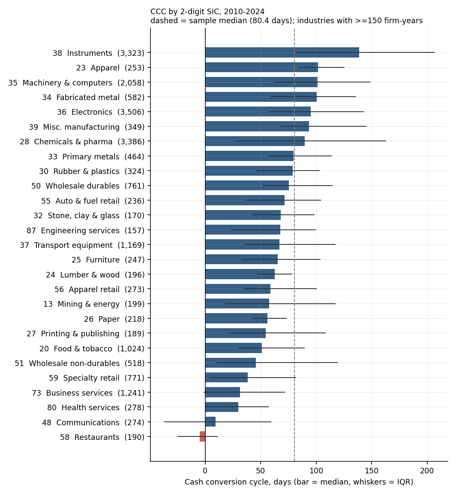
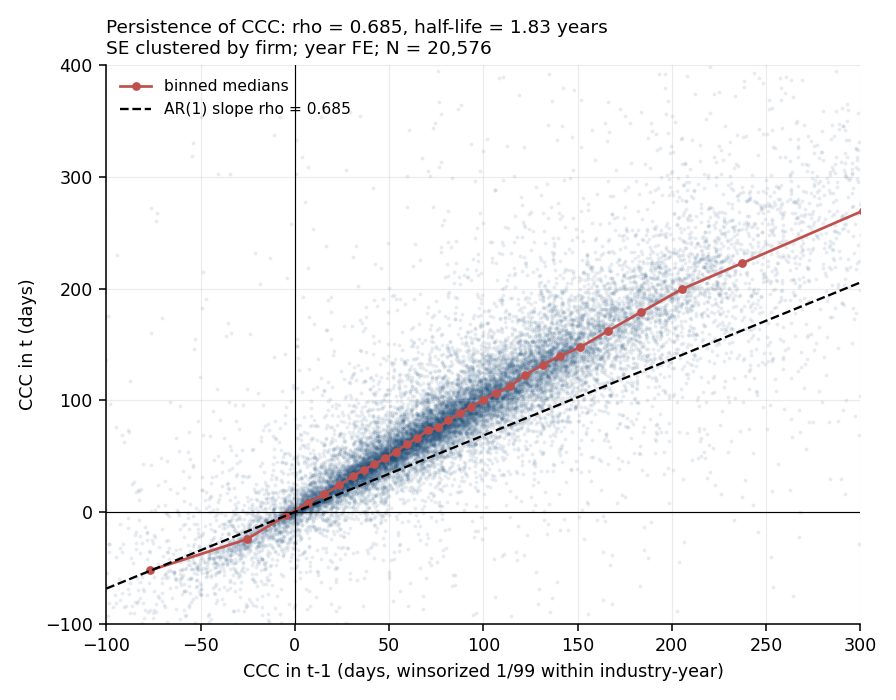
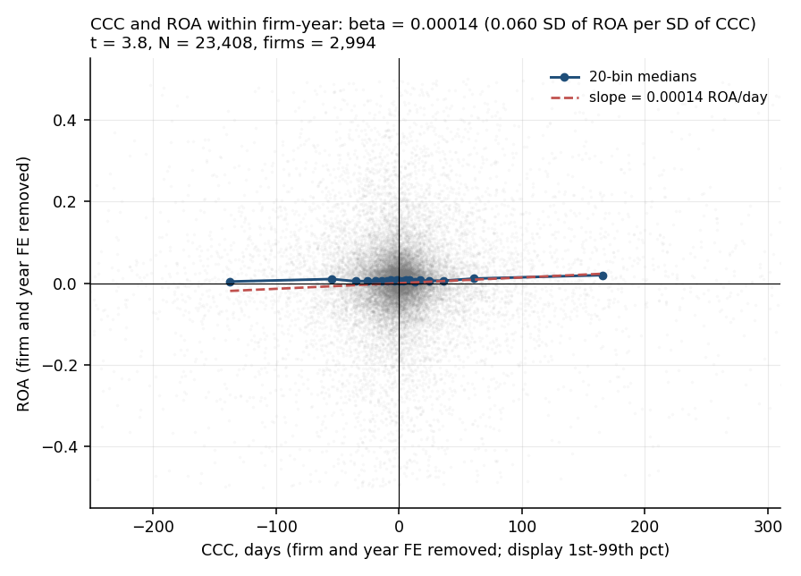
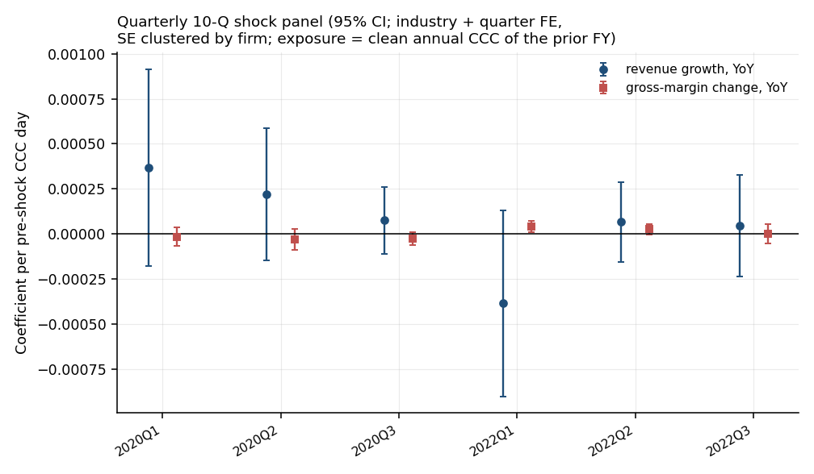

# Cash Conversion and Resilience - 15 Years of SEC Filings

[](https://github.com/magnumjpg/sec-cash-conversion-cycle/actions/workflows/ci.yml) [](#) [](https://www.python.org/) [](LICENSE) [](DATA.md)

[Resumen en español](#resumen-en-español) · [Method](METHOD.md) · [Limitations](LIMITATIONS.md) · [Decisions](DECISIONS.md)

**US listed firms hold about 80 days of working capital in their cash conversion cycle, and the level is mostly a firm trait rather than an industry one.**

*SEC XBRL · 2010–2024 · 26,974 firm-years · 3,320 firms · clean-AP headline on 24,272 firm-years · 38 tests*

---

## At a glance

- **Question:** how long is the cash conversion cycle (CCC) of US listed firms, and is it associated with profitability and with the 2020/2022 shocks?
- **Data:** SEC XBRL Financial Statement Data Sets, fiscal years 2010–2024, **26,974 firm-years / 3,320 firms**. The clean trade-AP headline uses **24,272 firm-years / 3,010 firms**.
- **Method:** CCC from fiscal-year-end balances; firm+year FE with capital-intensity and asset-turnover controls for the ROA association; pooled and firm-FE AR(1) for persistence; a separate 10-Q panel for the shocks.
- **Headline:** clean-AP pooled firm-year median CCC **80.38 days** (median of firm-level medians **74.19**); all-row mixed-AP sensitivity **75.42**. CCC–ROA **β = +0.000130** (t = 3.23), but **+0.000525** between firms and not a within-firm lever.
- **Caveat:** the AP fallback is reconstructed only where the accrual split exists (**2.56%** of fallback rows); the remaining **2,702** contaminated firm-years are excluded from the headline. Persistence is a **range (ρ ≈ 0.24–0.69)**, and everything here is descriptive.

**The answer in one paragraph.** The clean-AP pooled firm-year median CCC is **80.4 days** on 24,272
firm-years (the median of firm-level medians is 74.2), and CCC is mostly a
*firm* trait rather than an industry one (64.5% of its variance is between
firms, 6.2% between industries). Persistence is a **range, not a point**: a
pooled AR(1) gives ρ = 0.688 (half-life 1.9 years, biased up by persistent
between-firm differences), a firm-FE AR(1) gives 0.243 (half-life 0.5 years,
Nickell-biased down), and an Anderson–Hsiao IV gives 0.413. In this sample CCC
is *positively* associated with ROA (β = +0.000130, n = 22,811), but the
between-firm coefficient is four times larger (+0.000525) and the within-firm
coefficient is not a story about "longer CCC": it loads positively on
receivables and negatively on payables. The 2020/2022 shock exposure is not
detectable once the outcome is measured in calendar quarters with a pre-shock
balance sheet.

## 1. Building the panel

The panel is built from SEC XBRL filings, not from a vendor. The source is the
SEC Financial Statement Data Sets (bulk extracts of the same facts as
`companyfacts`), 2010q1–2025q4 quarterly extracts. Reasons for preferring the
bulk files, and the checks that were run before switching, are in
`DECISIONS.md → D-01`.

| Step | Firm-years |
|---|---:|
| Flow and balance facts matched on the same fiscal-year end | 117,001 |
| − duplicate fiscal-year label | −1,567 |
| − fiscal year outside 2010–2024 | −9,556 |
| **In the 2010–2024 window** | **105,878** |
| − missing revenue / COGS / AR / inventory / AP | −76,218 |
| − revenue ≤ 0 or COGS ≤ 0 | −279 |
| − negative balance-sheet item | −1 |
| − financials & real estate (SIC 6000–6999) | −390 |
| − utilities (SIC 4900–4999) | −474 |
| − fewer than 3 usable years | −1,542 |
| **Main sample** | **26,974** |
| of which clean trade AP (direct or reconstructed) | 24,272 |

The 76,218-row missing-input drop is not one homogeneous bucket. Inventory is
missing in 63,376 of those rows (83.2%), COGS in 55,285 (72.5%), AR in 47,795
(62.7%), AP in 28,551 (37.5%) and revenue in 26,073 (34.2%); 56,799 rows
(74.5%) miss more than one input and 19,419 (25.5%) miss exactly one. The item
counts overlap and sum to 221,080 item-cells, so they must not be read as
disjoint groups. The full table is `outputs/tables/attrition_missing_items.csv`.

The main sample covers **3,320 firms**, fiscal years **2010–2024**, and **59
two-digit SIC industries** (28 with at least 150 firm-years). Coverage is
**1,411 to 2,062 firm-years per year** (lowest in 2024, highest in 2012); the
decline is not decomposed here. Tag choices are explicit and counted
in `outputs/tables/tag_usage.csv`; `DATA.md` reports the full attrition and tag
usage. An **internal spot check** against the `companyfacts` API for Fastenal,
Walmart and Apple is **63/63 exact matches** across 7 concepts and 3 fiscal
years (`outputs/validation.json`). The denominator is every comparison the
design sets out to make, not only the ones that returned a value: the match
allows a ±7-day gap because the panel stores month-end fiscal-year ends while
`companyfacts` stores the issuer's exact period end (Apple's FY2019 10-K closes
on 2019-09-28). This check validates the extractor's parsing and period
alignment for three issuers; it does **not** validate the tag choice, the
ordered fallback logic or coverage of the wider panel.

All ratios use fiscal-year-end balances. Lags are used only when consecutive
fiscal-year ends are 350–380 days apart, so a year-end change does not create a
fake 15-month year.

## 2. Level and structure

| Measure | Median, days |
|---|---:|
| DSO (receivables / revenue) | 49.69 |
| DIO (inventory / COGS) | 83.98 |
| DPO (clean trade payables / COGS) | 47.91 |
| **CCC = DSO + DIO − DPO** | **80.38** |

The components are separate median days on 24,272 clean-AP firm-years, so they
do not add up: 49.69 + 83.98 − 47.91 = 85.76. The **pooled firm-year median CCC
is 80.38 days**, while the **median of firm-level median CCC is 74.19 days**;
the two are different statistics and neither is "the" median firm. The 5.4-day
gap between 85.76 and 80.38 is not an error; it is what happens when medians of
ratios are combined. The CCC row is the headline; the component rows describe
the distribution of each term.

The cross-section is wide (p25 = 35.09, p75 = 138.37) and **11.64% of clean-AP
firm-years have a negative CCC**; the all-row mixed-AP share is 15.33%. Industry
medians run from **−4.97 days in restaurants** to **138.71 days in
instruments**; communications (9.55) and agriculture (129.81) are the other
extremes. Restaurants are the clearest "negative CCC as a business model"
group: they collect from diners before they pay suppliers.



*Figure 1. Median cash conversion cycle by two-digit SIC industry, 2010–2024. Bars are industry medians, whiskers the interquartile range, and the dashed line the 80-day sample median; only industries with at least 150 firm-years are shown. Source: `outputs/figures/fig1_ccc_by_industry.png`.*

### 2a. The AP fix: reconstruct trade payables, exclude what cannot be split

`AccountsPayableAndAccruedLiabilitiesCurrent` is AP **plus accrued
liabilities**, not a like-for-like trade payable. Using it as a fallback raises
DPO and lowers CCC. The current mapping therefore does three things:

1. **Direct trade AP** is `AccountsPayableCurrent` or
   `AccountsPayableTradeCurrent` - **24,201 firm-years**.
2. **Reconstructed AP** is `AccountsPayableAndAccruedLiabilitiesCurrent −
   AccruedLiabilitiesCurrent`, kept only when the residual is positive  - 
   **71 firm-years**.
3. **Contaminated AP** is the combined tag with no usable accrual split  - 
   **2,702 firm-years**. It is excluded from the clean headline and kept only in
   the all-row sensitivity.

The reconstruction is deliberately conservative: it recovers only **2.56% of
the 2,773 fallback rows**, because the combined tag is used precisely when the
issuer does not report the accrual split. The result is a clean-AP sample of
24,272 rows / 3,010 firms (89.98% of the panel), and a transparent mixed-AP
sensitivity of 26,974 rows.

| AP measurement | Firm-years | CCC median, days | DPO median, days | Negative CCC |
|---|---:|---:|---:|---:|
| Direct trade AP | 24,201 | 80.53 | 47.90 | 11.53% |
| Reconstructed AP | 71 | 7.24 | 90.41 | 47.89% |
| **Clean AP (direct + reconstructed)** | **24,272** | **80.38** | **47.91** | **11.64%** |
| Contaminated AP (combined tag, no split) | 2,702 | 3.69 | 112.39 | 48.22% |
| All rows (mixed AP, sensitivity) | 26,974 | 75.42 | 50.69 | 15.33% |

The contaminated rows are not a random fringe: they are **10.0% of the panel**,
and their median CCC is 3.7 days against 80.4 on clean AP. Including them would
make the headline look like a business-model fact when it is partly an
accounting-convention artefact. The clean headline is therefore the primary
number; the mixed-AP median (75.42) is reported as a sensitivity and is not used
in the regressions. In the pre-filter tagged universe the combined tag is used
by 20.5% of firm-years that report any AP tag (`tag_usage.csv`); after the
panel's input filters it is 10.3% of rows.

### 2b. What explains the level

The decomposition is two partitions, not one. On the screened, winsorized
sample (n = 23,232):

- **between industries vs within industries:** 6.24% between 2-digit SIC
  industries, 93.76% within them;
- **between firms vs within firms over time:** 64.54% between firms, 35.46%
  within a firm across years.

The two shares cannot be added: "between industries" is nested inside "between
firms", so 6.24 + 64.54 + 35.46 = 106.24, not 100. Industry labels explain very
little; unobserved firm-level factors - business model, bargaining power,
product mix - account for most of the level differences. This is why the rest
of the project estimates firm effects rather than treating "industry practice"
as the unit of analysis.

Headline medians are computed on the **unscreened** sample, as the primary empirical specification
requires. Raw means are unusable - mean CCC is 114.1 days with an SD of 103,060
 -  because roughly 4% of clean-AP rows are not interpretable at face value
(mostly XBRL scale errors: assets tagged in millions, COGS off by 1,000×, plus
micro-caps). For estimation only, rows with |CCC| > 3,650 days, assets < $1m or
revenue < $1m are dropped: **1,040 rows (4.28%)**. The screen is not neutral:
the dropped group has a median CCC of −108.29 days, and the kept sample's median
is 82.05 days. That difference is disclosed, not hidden.

## 3. Persistence: a range, bounded by two biased estimators

Two estimators bracket the AR(1) coefficient; neither is the truth on its own.

- **Pooled AR(1):** `CCC_it = α + ρ·CCC_i,t−1 + year FE`, SEs clustered by firm,
  **no firm FE**. ρ = **0.688** (half-life 1.86 years). Because time-invariant
  firm differences remain in the error, this estimate is **biased upward** as a
  measure of within-firm persistence.
- **Firm-FE AR(1):** the same model with firm fixed effects. ρ = **0.243**
  (half-life 0.49 years). With T ≈ 10, a lagged dependent variable and firm FE
  is **Nickell-biased downward**, so this is a lower bound.
- **Anderson–Hsiao IV:** first differences with year dummies, instrumenting the
  lagged difference with the twice-lagged level. ρ = **0.413** (SE 0.145,
  N = 14,225), between the two.

The defensible statement is a range of roughly **0.24–0.69**, with a half-life
of roughly **0.5–1.9 years**, not a point estimate. The pooled
`1 − ρ = 0.312` is an implication of that pooled AR(1), not the within-firm
speed at which a firm's gap to its long-run CCC closes; this design does not
identify the latter.

| Specification | ρ | Half-life, years | N |
|---|---:|---:|---:|
| **Pooled AR(1) (winsorized clean CCC, year FE, no firm FE)** | **0.688** (SE 0.024) | **1.86** | 20,110 |
| Firm FE (Nickell-biased downward) | 0.243 (SE 0.048) | 0.49 | 20,110 |
| Anderson–Hsiao IV (first differences) | 0.413 (SE 0.145) | 0.78 | 14,225 |
| Raw clean CCC, pooled | 0.552 | 1.17 | 20,197 |
| Drop \|CCC\| > 365 days, pooled | 0.543 | 1.14 | 19,447 |
| Average balances, pooled | 0.782 | 2.82 | 17,113 |
| DSO only (winsorized), pooled | 0.727 | 2.17 | 20,110 |
| DIO only (winsorized), pooled | 0.655 | 1.64 | 20,110 |
| DPO only (winsorized), pooled | 0.584 | 1.29 | 20,099 |



*Figure 2. Pooled AR(1) of the cash conversion cycle: CCC in year t against year t−1, with 20-bin medians and the fitted slope ρ = 0.688 (half-life 1.86 years, N = 20,110). Source: `outputs/figures/fig2_persistence.png`.*

The by-industry table uses the same **pooled** estimator (year FE only, so it
mixes between- and within-firm variation) and is labelled that way in
`outputs/tables/persistence_by_industry_ccc_clean.csv`; a firm-FE ρ is reported
alongside it for every industry where the within transformation is estimable.
Those industry firm-FE estimates are noisy, and one is slightly negative, so
they should not be read as precise industry speeds.

CCC is persistent enough to be a meaningful firm characteristic, but the data
do not support a single "X% of the gap closes each year" claim: the pooled and
within estimators disagree by a factor of about 2.8.

## 4. CCC and ROA: positive, small, and mostly *between* firms

`ROA_it = α_i + δ_t + β·CCC_it + γ·log(assets)_it + θ·gross_margin_it + κ·capital_intensity_it + λ·asset_turnover_it + ε_it`,
firm and year fixed effects, SEs clustered by firm, CCC and ROA winsorized 1/99
within industry-year. Capital intensity is net PP&E / assets (with a
non-current-asset fallback) and asset turnover is revenue / assets; both are new
in mapping 2.0.0, so the positive coefficient is not just a capital-intensity proxy.

| | Estimate |
|---|---:|
| β (ROA per CCC day) | **+0.000130** |
| SE / t / p | 0.000040 / 3.23 / 0.0012 |
| Standardized β (SD of ROA per SD of CCC) | 0.055 |
| N / firms | 22,811 / 2,877 |
| Within R² | 0.071 |
| Same model, no controls | +0.000124 (t = 3.09) |
| Industry × year FE | +0.000131 (t = 3.42) |
| **Between-firm regression (firm means)** | **+0.000525** (t = 4.80) |

The sign is **positive**: 100 extra CCC days are associated with **+1.30
percentage points of ROA**, or 0.055 SD per SD. This contradicts the theoretical
prior ("expect negative β") and should be stated plainly. But the number is a
composition fact more than a within-firm lever:

- The **between-firm** coefficient (+0.000525) is about four times the headline.
  Firms that systematically run longer cycles - instruments, machinery,
  made-to-order manufacturing - also earn higher margins. That is a
  cross-sectional association, not evidence that lengthening a firm's cycle
  raises its ROA.
- The **within-firm** coefficient is identified by changes in a firm's own CCC.
  Splitting the index into its components on the same sample gives **DSO
  +0.000473** (t = 3.18), **DIO −0.000055** (t = −1.73, p = 0.084) and **DPO
  −0.000108** (t = −3.35). The positive within-firm loading is on receivables
  (sales growth and credit terms), while **more payables are associated with
  lower ROA**, the opposite of the naive "stretch payables" reading.
- The **rank check** confirms that the median firm does not show the linear
  pattern: within-firm Spearman correlation of CCC and ROA has median −0.014 and
  is positive in only 47.2% of 2,734 firms. The linear coefficient is identified
  by firms with larger CCC variation.

The sign holds in **all 13 main-sample specifications** (12 ROA variants and a
2020 growth placebo), but only **9 of 13** are significant at 5%
(`robustness_summary.n_significant_p05`), ranging from +0.000004 with average
balances (p = 0.895) to +0.000300 when |CCC| > 365 is dropped. The cleanest tag measurement  - 
spec 11, which requires the preferred standard taxonomy tag for every input - is weaker
still (β = +0.000122, p = 0.086, n = 4,543), so the tag mixture is not generating
the positive sign, but it does flatter its precision.



*Figure 3. Cash conversion cycle and ROA with firm and year fixed effects removed, with 20-bin medians and the fitted slope β = +0.000130 (t = 3.23, N = 22,811). Source: `outputs/figures/fig3_ccc_vs_roa.png`.*

## 5. Shock exposure: annual and quarterly

### 5a. Annual cross-sections

Cross-sections with 2-digit SIC fixed effects and HC1 standard errors;
pre-shock CCC is the winsorized lagged clean-AP value. Descriptive only. The
labels are issuer **fiscal years**, not calendar windows: 29.0% of FY2020 rows
and 28.3% of FY2022 rows have a non-December year-end, so a June-ending firm's
"FY2020" covers July 2019–June 2020. A December-only re-estimation is reported
below.

| Outcome | β per CCC day | t | N |
|---|---:|---:|---:|
| FY2020 revenue growth (FY2019→FY2020) | +0.000151 | 0.65 | 1,326 |
| FY2020 ROA | +0.000169 | 2.20 | 1,324 |
| FY2020 cash / assets | −0.000007 | −0.14 | 1,306 |
| FY2020 inventory write-down / COGS | +0.000006 | 0.09 | 223 |
| FY2022 gross-margin change (FY2021→FY2022), β × 100, pp | −0.0060 | −2.06 | 1,397 |
| FY2022 ROA | −0.000101 | −1.02 | 1,396 |
| FY2022 inventory write-down / COGS | −0.000013 | −0.15 | 269 |

| December year-ends only | β per CCC day | t | N |
|---|---:|---:|---:|
| FY2020 revenue growth | +0.000211 | 0.81 | 918 |
| FY2020 ROA | +0.000185 | 2.29 | 917 |
| FY2020 write-down / COGS | +0.000017 | 0.23 | 169 |
| FY2022 gross-margin change, β × 100, pp | −0.0056 | −1.50 | 992 |
| FY2022 ROA | −0.000078 | −0.76 | 991 |
| FY2022 write-down / COGS | −0.000034 | −0.36 | 215 |

- **FY2020 demand shock:** revenue growth is not detectable (t = 0.65, and
  t = 0.81 on December year-ends), so the data cannot distinguish "no
  association" from "too imprecise to see one". The quintile pattern is
  non-monotone. The FY2020 ROA coefficient is positive (t = 2.20) but
  non-monotone across quintiles, and cash holdings show nothing (t = −0.14).
  Write-downs, now measured, show nothing (t = 0.09).
- **FY2022 cost shock:** the full-sample linear margin slope is negative
  (−0.006 pp per CCC day, i.e. −0.6 pp per 100 days, t = −2.06), but the
  December-only slope is −0.0056 with t = −1.50, so it does not survive the
  calendar-aligned check at 5%. The quintile medians are **not monotone**. The
  slope is driven by both tails, not by a clean dose–response. FY2022 ROA and
  write-downs are flat.

### 5b. Quarterly 10-Q panel

The annual 10-K panel cannot resolve a shock that lasted weeks. A separate
quarterly panel is built from the 2019q1–2022q4 FSDS cache, keeping 10-Q/10-Q/A
forms and one-quarter flows (`qtrs == 1`) with instant balances (`qtrs == 0`).
It yields **72,811 firm-quarters / 8,097 firms / 20 quarters**; the shock
sample (period ends in calendar Q1–Q3 of 2020 or 2022, with an annual pre-shock
balance sheet) is **8,588 firm-quarters / 1,852 firms**.

Two design choices matter:

- **Calendar window, not the issuer's `fy` label.** `quarter` is derived from
  the period-end date. A 10-Q for a period ending March 2020 is 2020Q1 even if
  the filing's fiscal-year focus says 2019 or 2021; a handful of filings carry
  implausible `fy` labels, and the shock is calendar time.
- **Exposure is the prior fiscal year.** The 10-Q's own `fy` is mostly the
  shock year (a December filer's 2020Q1 10-Q carries fy = 2020), so merging on
  it would put exposure and outcome in the same year. The panel instead joins
  each row to the annual clean-AP CCC for `shock_year − 1` (FY2019 for 2020,
  FY2021 for 2022). This is the corrected specification; the earlier draft used
  the 10-Q `fy` and produced a spurious 2022 cash/assets result.

| Outcome | 2020 β (t) | 2022 β (t) |
|---|---:|---:|
| YoY revenue growth | +0.000211 (1.48) | −0.000075 (−0.61) |
| YoY gross-margin change | −0.000024 (−1.46) | +0.000023 (1.89) |
| Cash / assets | −0.000013 (−0.68) | −0.000007 (−0.43) |
| Write-down / COGS | +0.000193 (0.94) | −0.000105 (−0.96) |

Industry and calendar-quarter FE, SEs clustered by firm. **No pooled
coefficient clears 5%.** The closest is the 2022 gross-margin change (positive,
p = 0.059); the 2022Q1 cell alone is positive and significant (p = 0.011), but
with 24 quarter-outcome cells that is consistent with multiple testing, and the
pooled estimate is not. The annual FY2022 negative margin slope is therefore
**not confirmed** at quarterly resolution: the sign flips and the coefficient is
imprecise. Read together, the shock evidence is a set of null, imprecise
estimates, not a resilience result in either direction.



*Figure 7. Coefficient on pre-shock clean CCC, one point per (shock year, calendar quarter), 95% CI from firm-clustered SEs. Source: `outputs/figures/fig7_quarterly_shock.png`.*

Write-down tags are now extracted: **4,657 panel rows (17.3%) / 959 firms**
report `InventoryWriteDown` (or `InventoryImpairmentLoss`). The outcome is
estimated on that selected subsample and is not representative of firms that do
not report the tag.

## 6. What this does not prove

- **No causality.** CCC is chosen jointly with industry, growth, bargaining
  power, supplier terms and product mix. A positive CCC–ROA coefficient does not
  mean that lengthening CCC raises ROA.
- **No dollar value of a CCC day.** That needs a cost of capital, a financing
  mix and an assumption about what happens to the freed cash. It is not
  identified here and is deliberately not computed.
- **No market test.** Without CRSP/Compustat there are no returns or event
  windows; "resilience" is accounting profitability and cash only.
- **The annual shock exercises are cross-sections.** One observation per firm
  plus industry FE cannot separate CCC from an unobserved firm trait correlated
  with it. The quarterly panel has repeated observations, but its exposure is
  still a single pre-shock annual balance, and the tests are descriptive.
- **Not representative of all listed firms.** Requiring inventory and COGS
  selects industrial and retail firms, so the negative-CCC share is a lower
  bound for the listed universe on that dimension. On clean AP it is 11.64%;
  the contaminated combined-tag rows are 48.22% negative, which is one reason
  they are excluded.
- **The clean-AP headline is a selected 90% of rows.** Reconstruction recovers
  only 2.56% of fallback rows; the other 2,702 firm-years are excluded. If the
  excluded firms differ systematically, the 80.38-day median is not the
  all-firm median. The all-row sensitivity (75.42) is the bound in the other
  direction.
- **No identified within-firm adjustment speed.** The pooled AR(1) (0.688) is
  biased up by persistent firm differences and the firm-FE AR(1) (0.243) is
  Nickell-biased down; the data bound the parameter, they do not pin it down.
- **Definition sensitivity.** Winsorization, trimming and the persistence
  estimator move the persistence estimate between 0.24 and 0.69 and the ROA
  coefficient between 0.000004 and 0.000300. Full list: `LIMITATIONS.md`.
- **A null quarterly result is not "no effect".** The 10-Q estimates are
  imprecise; they fail to detect an association, they do not rule one out.

## 7. Literature and positioning

The working-capital literature mostly reports a *negative* association between
CCC and profitability; this panel is a descriptive measurement exercise, not a
causal test, and its positive coefficient is a fact to explain rather than a
policy lever.

- **Deloof (2003), "Does Working Capital Management Affect Profitability of
  Belgian Firms?", *Journal of Business Finance & Accounting*.** Establishes the
  negative CCC–profitability prior on firm-level panel data; informs the
  benchmark this project contradicts.
- **García-Teruel & Martínez-Solano (2007), "Effects of Working Capital
  Management on SME Profitability", *International Journal of Managerial
  Finance*.** Extends that prior to small firms and short panels; informs the
  role of sample composition.
- **Hill, Kelly & Highfield (2010), "Net Operating Working Capital Behavior: A
  First Look", *Financial Management*.** Documents large cross-firm differences
  in working-capital intensity; motivates the between-firm variance
  decomposition here.
- **Baños-Caballero, García-Teruel & Martínez-Solano (2014), "Working Capital
  Management, Corporate Performance, and Financial Constraints", *Journal of
  Business Research*.** Shows the CCC–performance relation can be non-linear and
  financing-constrained; informs why a single linear slope is only descriptive.
- **Aktas, Croci & Petmezas (2015), "Is Working Capital Management
  Value-Enhancing? Evidence from Firm Performance and Investments", *Journal of
  Corporate Finance*.** Links working-capital adjustment to investment and
  value; informs the interpretation of CCC as a firm trait rather than a free
  lever.
- **Fazzari & Petersen (1993), "Working Capital and Fixed Investment", *RAND
  Journal of Economics*.** Treats working capital as a financing constraint;
  informs the 2020/2022 shock framing and the limits of an accounting-only
  resilience test.
- **Bates, Kahle & Stulz (2009), "Why Do U.S. Firms Hold So Much More Cash than
  They Used To?", *Journal of Finance*.** Documents the secular rise in
  corporate liquidity; informs the cash/assets outcome and the need to separate
  cash policy from working-capital policy.

The gap this project fills is measurement, not identification: the contribution
is a reproducible 2010–2024 XBRL panel with **tag-level provenance for every
input**, an explicit trade-AP reconstruction, and a disclosure of what the tag
mix does to the headline level. It is not a causal estimate of the return to
shortening the CCC, and it does not use the CRSP/Compustat data that most of the
cited papers use.

## 8. Reproduce

```
python src/download_sec.py            # annual cache (no-op if present)
python src/download_sec.py --quarterly # 10-Q cache for the shock panel
python src/run_all.py                 # panel → quarterly panel → results → figures
python src/run_all.py --test          # same + pytest
python src/analysis.py                # re-estimate only
python src/analysis_quarterly.py      # quarterly shock tests only
python src/figures.py                 # redraw figures only
```

`outputs/run_log.json` records each step's status, duration and error (if any).
The pipeline reruns fully offline from `data/raw/`; `data/manifest.json` pins
the URL, byte size and SHA-256 of every source file. All JSON outputs are strict
JSON: undefined numbers are written as `null`, never `NaN` or `Infinity`. Data
volumes, cache layout and the full attrition funnel are in `DATA.md`.

| Command | Status |
|---|---|
| `python src/download_sec.py` | ok - 64/64 annual quarters cached |
| `python src/download_sec.py --quarterly` | ok - 16/16 quarterly quarters cached |
| `python src/build_panel.py` | ok - 26,974 / 3,320 |
| `python src/build_quarterly.py` | ok - 72,811 firm-quarters / 8,097 firms |
| `python src/analysis.py` | ok |
| `python src/analysis_quarterly.py` | ok - 8,588 shock firm-quarters |
| `python src/figures.py` | ok - 7 figures |
| `python src/verify_known_firms.py` | ok - internal spot check 63/63 |
| `python src/run_all.py --skip-download --test` | ok - 38 tests passed |

## 9. Files

```
02_working_capital_sec/
  README.md  DATA.md  METHOD.md  LIMITATIONS.md  DECISIONS.md
  RED_TEAM.md  ANALYSIS_LOG.md  .gitignore
  src/
    tags.py              tag mapping 2.0.0; trade-AP reconstruction rule
    json_utils.py        strict JSON writers (NaN/Infinity -> null)
    download_sec.py      SEC FSDS download, cache, manifest, rate limit
    build_panel.py       facts → firm-year panel, clean AP, attrition, measures
    build_quarterly.py   facts → firm-quarter 10-Q panel, calendar labels
    analysis.py          descriptives, persistence, CCC–ROA, shocks, robustness
    analysis_quarterly.py quarterly shock regressions
    figures.py           7 figures, every annotation read from results.json
    verify_known_firms.py  spot check vs companyfacts
    run_all.py           one-command orchestration
  tests/test_pipeline.py
  data/
    manifest.json        URLs + bytes + sha256 of every cached file
    processed/panel.csv  main sample (26,974 rows)
    processed/quarterly_panel.csv  10-Q panel (72,811 rows)
    raw/                 not committed; rebuilt from the manifest (DATA.md)
  outputs/
    results.json         canonical annual numbers used in this README
    quarterly_results.json  canonical quarterly shock numbers
    quarterly_stats.json quarterly build log
    validation.json      internal spot check (Fastenal / Walmart / Apple)
    tables/*.csv         attrition, missing-input decomposition, tag usage,
                         industry/year summaries, robustness, quarterly shocks
    figures/*.png        7 figures
  requirements.txt       pinned Python dependencies
  LICENSE                MIT
  .github/workflows/ci.yml  install + pytest on Python 3.11
```

Figures: [CCC by industry](outputs/figures/fig1_ccc_by_industry.png) (fig1),
[persistence scatter](outputs/figures/fig2_persistence.png) (fig2),
[CCC vs ROA within firm-year](outputs/figures/fig3_ccc_vs_roa.png) (fig3),
[2020 shock exposure](outputs/figures/fig4_shock_2020.png) (fig4),
[CCC time series](outputs/figures/fig5_ccc_time_series.png) (fig5),
[2022 margin change by pre-shock CCC quintile](outputs/figures/fig6_shock_2022.png) (fig6)
and [quarterly shock coefficients](outputs/figures/fig7_quarterly_shock.png) (fig7).

## Appendix - Headline numbers, all from `outputs/results.json`

| Key | Value |
|---|---:|
| `panel.rows` / `panel.firms` | 26,974 / 3,320 |
| `panel.rows_clean_ap` / `panel.firms_clean_ap` | 24,272 / 3,010 |
| `panel.median_ccc` | 80.382955 |
| `panel.median_ccc_all_rows` | 75.424063 |
| `tag_sensitivity.median_of_firm_median_ccc` | 74.188054 |
| `panel.share_negative_ccc` / `.share_negative_ccc_all_rows` | 0.116389 / 0.153296 |
| `ap_quality.counts.direct` / `.reconstructed` / `.fallback_contaminated` | 24,201 / 71 / 2,702 |
| `tag_sensitivity.reconstructed_share_of_fallback` | 0.025604 |
| `tag_sensitivity.contaminated_ap.ccc_median` / `.dpo_median` | 3.687616 / 112.386667 |
| `tag_sensitivity.clean_ap.ccc_median` / `.dpo_median` | 80.382955 / 47.914705 |
| `tag_sensitivity.preferred_only_ccc_roa.beta` / `.p` | 0.000122 / 0.085632 |
| `descriptives.variance_decomposition.share_between_industries_sic2` | 0.062432 |
| `descriptives.variance_decomposition.share_between_firms` | 0.645399 |
| `persistence.beta` / `persistence.half_life_years` | 0.688343 / 1.855973 |
| `persistence.with_firm_fe.rho` / `.half_life_years` | 0.243035 / 0.490012 |
| `persistence.anderson_hsiao.rho` / `.se` | 0.413266 / 0.144740 |
| `robustness_summary.n_significant_p05` / `.n_specs_main_sample` | 9 / 13 |
| `ccc_roa.beta` / `ccc_roa.t` | 0.000130 / 3.232304 |
| `ccc_roa.beta_standardized` | 0.055291 |
| `ccc_roa_between.beta` / `.t` | 0.000525 / 4.802147 |
| `ccc_roa_components.dso.beta` / `.t` | 0.000473 / 3.177519 |
| `ccc_roa_components.dpo.beta` / `.t` | −0.000108 / −3.354662 |
| `shock_2020.revenue_growth.t` | 0.651151 |
| `shock_2020.write_down.t` | 0.088225 |
| `shock_2022.margin_change.beta` / `.t` | −0.000060 / −2.060164 |
| `shock_window.shock_2022_december.margin_change.t` | −1.498543 |
| `rank_check.median_spearman` / `.share_positive` | −0.014286 / 0.471836 |
| `validation.n_match` / `validation.n_comparisons` | 63 / 63 |
| `shock_quarterly.n_firm_quarters` / `.n_firms` | 8,588 / 1,852 |

Note: the quarterly appendix numbers are from `outputs/quarterly_results.json`,
which is embedded in `results.json → shock_quarterly`.

---

## Resumen en español

El proyecto construye un panel de **26.974 empresas-año (3.320 empresas, 2010–2024)** a partir de los ficheros XBRL de la SEC, no de un proveedor de datos. La medida principal usa **acreedores comerciales limpios**: 24.272 empresas-año (3.010 empresas) con la etiqueta directa de acreedores o con el residuo `acreedores + devengos − devengos corrientes`; las 2.702 filas en las que ese residuo no puede reconstruirse se excluyen del titular. El ciclo de conversión de caja (CCC) mediano agrupado es de **80,38 días** (mediana de las medianas por empresa: 74,19; DSO 49,69; DIO 83,98; DPO 47,91; los componentes son medianas separadas y no suman 80,38), y un **11,64%** de las observaciones limpias tiene CCC negativo (15,33% si se incluyen las filas contaminadas, que no son comparables).

La reconstrucción recupera solo el **2,56%** de las filas con la etiqueta combinada, porque esa etiqueta se usa precisamente cuando no existe el desglose de devengos. Las filas contaminadas tienen un CCC mediano de 3,69 días y un DPO de 112,39, frente a 80,38 y 47,91 en la muestra limpia; incluirlas haría parecer un hecho de modelo de negocio lo que en parte es una convención contable.

El resultado estructural más interesante es que **solo el 6,24% de la varianza del CCC es entre industrias** (93,76% dentro de ellas) y que el **64,54% es entre empresas** (35,46% dentro de la misma empresa a lo largo del tiempo). Son dos particiones solapadas: no suman 100. La etiqueta sectorial explica muy poco; los factores no observados de la empresa explican la mayor parte.

La persistencia es un **rango, no un punto**: el AR(1) agrupado da ρ = 0,688 (semivida 1,86 años, sesgado al alza por diferencias persistentes entre empresas), el AR(1) con efectos fijos de empresa da 0,243 (semivida 0,49 años, sesgado a la baja por Nickell) y el IV de Anderson–Hsiao da 0,413; la verdad está entre ambos, aproximadamente 0,24–0,69. La asociación con la rentabilidad es **positiva y pequeña** (+1,30 puntos de ROA por cada 100 días de CCC, 0,055 desviaciones típicas), en contra de la hipótesis de partida, y 9 de las 13 especificaciones principales son significativas al 5%; con la etiqueta preferida en todas las entradas (especificación 11) el coeficiente es más débil (p = 0,086). Pero el coeficiente **entre empresas** (+0,000525) cuadruplica al titular, y por componentes el signo positivo carga en las cuentas por cobrar (DSO +0,000473) mientras que más acreedores se asocian con **menor** ROA (DPO −0,000108): no es una historia de "alargar el CCC mejora la rentabilidad". La correlación de rangos dentro de la empresa típica es prácticamente cero (mediana −0,014; positiva solo en el 47,2% de las empresas).

En los shocks de 2020 y 2022 no hay un patrón robusto. En el panel trimestral de 10-Q (8.588 empresas-trimestre, 1.852 empresas), con la exposición medida en el ejercicio anterior y una ventana de calendario Q1–Q3, **ningún coeficiente agrupado es significativo al 5%**: el crecimiento de ingresos de 2020 da t = 1,48, el cambio de margen bruto de 2022 da +0,000023 (t = 1,89, p = 0,059) y el resto es más débil. El resultado anual negativo del margen de 2022 (t = −2,06; t = −1,50 con cierres de diciembre) **no se confirma** trimestralmente: el signo cambia y la estimación es imprecisa. La conclusión honesta es descriptiva: el CCC es un rasgo de empresa más que de sector, su relación con la rentabilidad es débil y sobre todo entre empresas, y los shocks no permiten detectar un efecto de resiliencia.
